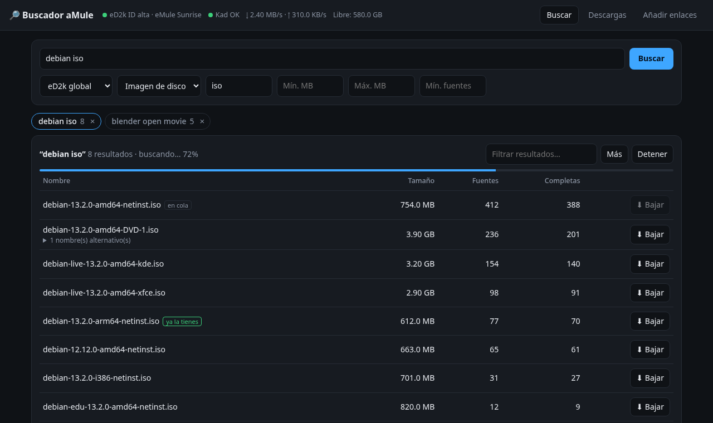
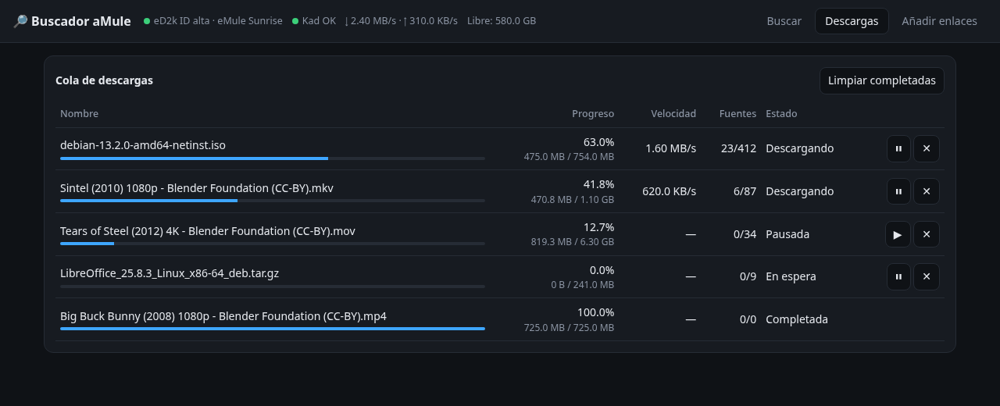
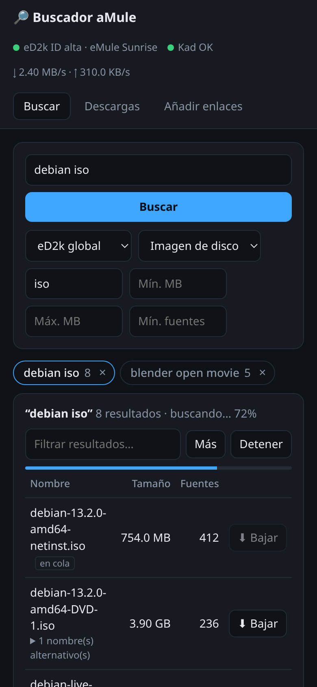

# Buscador aMule

Interfaz web propia (en español y adaptada al móvil) para buscar y descargar en la red eD2k/Kad.
Usa `amuled` (aMule 3.x, imagen `ngosang/amule`) y su API REST oficial (`amuleapi`).

```
Navegador ──► buscador (FastAPI, :8080) ──► amuleapi (:4711, solo red interna) ──► amuled ──► eD2k / Kad
```

## Capturas



| Cola de descargas | En el móvil |
|---|---|
|  |  |

<sub>Capturas con datos de ejemplo: ISOs de Debian, LibreOffice y películas libres (CC-BY) de la Blender Foundation.</sub>

## Puesta en marcha

```bash
cp .env.example .env        # y cambia las 3 contraseñas
mkdir -p data/config data/downloads
docker compose up -d --build
```

Abre `http://IP-DEL-SERVIDOR:8080` y entra con `APP_USER` / `APP_PASSWORD`.

La primera vez, aMule tarda uno o dos minutos en conectarse a Kad y a un servidor eD2k.
El indicador de arriba se pone en verde cuando la conexión está lista.

## ID alta (importante para descargar bien)

Abre en el router estos puertos hacia la máquina donde corre Docker:

| Puerto | Protocolo | Uso |
|-------:|-----------|-----|
| 4662 | TCP | eD2k cliente a cliente |
| 4665 | UDP | búsquedas globales eD2k |
| 4672 | UDP | Kad y eMule extendido |

Si no los abres, tendrás **ID baja**: funciona, pero con muchas menos fuentes.

## Qué hace

- **Buscar**: en eD2k global, Kad, ambas o el servidor local. Filtros por tipo, extensión, tamaño y fuentes mínimas.
  Puedes tener varias búsquedas abiertas como pestañas, ordenar por columnas y filtrar resultados.
  El botón «Más» amplía una búsqueda Kad en curso.
- **Descargas**: progreso, velocidad y fuentes. Permite pausar, reanudar, cancelar y limpiar las completadas.
- **Añadir enlaces**: pega enlaces `ed2k://` o `magnet:` (con hash ed2k).
- Los archivos terminados quedan en `data/downloads/incoming`.

## Notas

- La web oficial de aMule sigue disponible en `http://127.0.0.1:4711`, solo desde el propio servidor.
- No expongas el puerto 8080 a Internet sin HTTPS. Para acceder desde fuera, usa Tailscale/WireGuard
  o un proxy inverso con TLS (Caddy, Nginx Proxy Manager, Cloudflare Tunnel con Access).
- Úsalo con contenido que tengas derecho a descargar (distribuciones Linux, software libre, dominio público…).

## Estructura

```
docker-compose.yml        amuled + buscador
.env.example              variables y contraseñas
buscador/
  Dockerfile
  requirements.txt
  app/main.py             API propia (/api/...) y servidor de la web
  app/amule_client.py     cliente de la API REST de amuleapi (login JWT, reintento)
  app/static/index.html   interfaz (HTML + JS sin dependencias)
```

## Licencia

[MIT](LICENSE) © 2026 lagt-82
